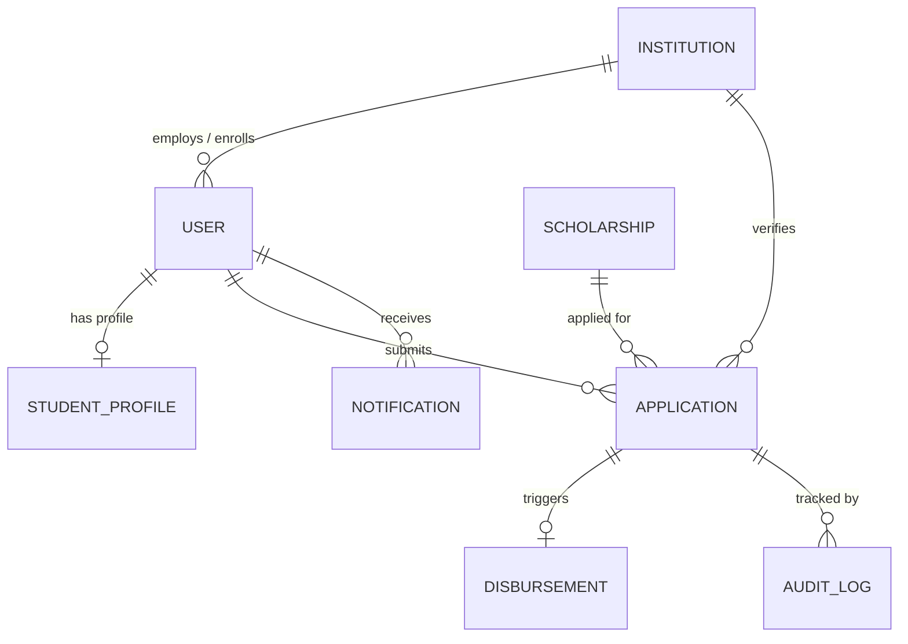

# PROJECT REPORT SUMMARY
## EduStream: Paperless Scholarship Disbursement Platform with RAG-Powered AI Advisory

---

### 1. PROJECT TITLE & METADATA
- **Project Name:** EduStream — Paperless Scholarship Disbursement Platform
- **Project Category:** Full-Stack Web Application / GovTech / EdTech / Artificial Intelligence
- **Architecture Pattern:** MERN Stack (MongoDB, Express.js, React 19, Node.js) with Dual-Mode RAG (Retrieval-Augmented Generation)
- **Target Users:** Students, College Verification Staff, Scholarship Board Administrators, State Treasury / Finance Officers
- **Academic Scope:** Final Year Project / Capstone Project / Software Engineering Demonstration

---

### 2. ABSTRACT / EXECUTIVE SUMMARY
Traditional scholarship disbursement systems in higher education suffer from chronic operational inefficiencies: extensive physical paperwork, fraudulent document submissions, verification bottlenecks at the institutional level, opaque approval cycles, and delayed fund transfers.

**EduStream** solves these systemic problems by digitizing the entire scholarship lifecycle from end-to-end:
1. **Paperless Digital Submission:** Meritorious and economically disadvantaged students build a persistent digital academic and bank profile, upload verified digital certificates (Income, Caste, Bonafide, Marksheets), and apply to schemes with zero physical paperwork.
2. **Multi-Tier Role-Based Scrutiny:** Implements a strict two-level verification protocol—Level 1 Institutional Scrutiny by college verifiers and Level 2 Central Sanction by state scholarship administrators.
3. **Transparent Direct Benefit Transfer (DBT):** Simulates the Public Financial Management System (PFMS) and National Payments Corporation of India (NPCI) Aadhaar-seeded transfer pipeline, generating unique 16-character UTR (Unique Transaction Reference) numbers and immutable disbursement receipts.
4. **Retrieval-Augmented Generation (RAG) AI Advisor:** Incorporates an intelligent AI advisor trained on official government circulars, Tehsildar issuing authority rubrics, and active scheme criteria. It delivers personalized eligibility evaluations based on the student's marks percentage, family income, category, and gender, complete with official citations and 1-click apply links.

---

### 3. PROBLEM STATEMENT & OBJECTIVES

#### 3.1 Existing Inefficiencies
- **Heavy Paper Trail:** Physical attestation, stamp papers, manual couriers between colleges and directorates.
- **Verification Bottlenecks:** College authorities take months to verify certificates manually, leading to missed student deadlines.
- **Fraud & Duplicate Claims:** Lack of central deduplication permits fraudulent or multi-scheme claims.
- **Opaque Payouts:** Students remain unaware of when, if, or to which bank account their funds were transferred.
- **Student Confusion:** Complex eligibility rules, differing income ceilings, and technical terms (DBT, PFMS, UTR) cause high rejection rates.

#### 3.2 Core Objectives of EduStream
- Build a responsive, accessible single-page application (SPA) for seamless student applications.
- Enforce strict Role-Based Access Control (RBAC) across four dedicated stakeholder portals.
- Provide institutional staff with an inline document scrutiny workspace with defect-marking workflows.
- Provide state administrators with scheme lifecycle management, budget allocation, and sanction tools.
- Provide finance officers with batch DBT voucher processing and UTR tracking.
- Embed a grounded RAG AI engine that answers questions and calculates student eligibility with zero hallucinations.

---

### 4. SYSTEM ARCHITECTURE & TECH STACK

```
+-----------------------------------------------------------------------------------+
|                                   CLIENT TIER                                     |
|  React 19 SPA + Vite + Tailwind CSS + Lucide Icons + React Router v7 + Axios     |
|                                                                                   |
|  [Student Portal]  [College Verification]  [Admin Board]  [Finance & DBT Treasury]|
|  [Floating RAG AI Assistant Widget]         [Public Policy Knowledge Base Page]   |
+------------------------------------------+----------------------------------------+
                                           | HTTP / REST + JSON + JWT
                                           v
+-----------------------------------------------------------------------------------+
|                                APPLICATION TIER                                   |
|                          Node.js (v20+) + Express.js API                          |
|                                                                                   |
|  Middleware: authMiddleware (JWT), roleMiddleware (RBAC), uploadMiddleware (Multer)|
|                                                                                   |
|  Core Controllers:                                                                |
|  - authController          - studentController         - verificationController    |
|  - scholarshipController   - applicationController     - disbursementController    |
|  - adminController         - notificationController    - ragController             |
+---------------------+-------------------------------------+-----------------------+
                      |                                     |
                      v                                     v
+-------------------------------------+   +-----------------------------------------+
|             DATA TIER               |   |            RAG AI ENGINE                |
|       MongoDB / Mongoose            |   |                                         |
|                                     |   | [Mode 1: Gemini 3.8 Flash via @google/genai]
| Collections:                        |   |  - High-dimensional embeddings          |
| - Users          - Institutions     |   |  - Multi-context grounded reasoning     |
| - StudentProfile - Scholarships     |   |                                         |
| - Applications   - Disbursements    |   | [Mode 2: Local Semantic Engine]         |
| - KnowledgeDocs  - AuditLogs        |   |  - TF-IDF & Cosine Vector Indexing      |
| - Notifications                     |   |  - Live Mongoose Scheme Synchronization |
+-------------------------------------+   |  - Student Profile Intersection Rules   |
                                          +-----------------------------------------+
```

#### Detailed Technology Choices
| Component | Technology | Version | Rationale |
| :--- | :--- | :--- | :--- |
| **Frontend Framework** | React.js | 19.2 | High performance concurrent rendering, component modularity |
| **Build Tool** | Vite | 8.3 | Instant Hot Module Replacement (HMR) and optimized build times |
| **Styling** | Tailwind CSS | 3.4 | Utility-first, responsive design matching modern gov portal standards |
| **Icons** | Lucide React | Latest | Clean, accessible iconography |
| **Backend Runtime** | Node.js | v20+ | High-throughput asynchronous event-driven I/O |
| **Server Framework** | Express.js | 4.21 | Robust routing, middleware ecosystem, and REST API standards |
| **Authentication** | JWT + Bcryptjs | 9.0 / 2.4 | Stateless, secure, token-based authentication with salted hashes |
| **Database** | MongoDB + Mongoose | 8.7 | Schema flexibility for varying scholarship criteria & audit histories |
| **Database Engine** | Embedded MongoMemoryServer | 10.4 | Allows zero-setup standalone execution for evaluators without local DB |
| **AI SDK** | `@google/genai` | 2.30 | Official SDK for Gemini 3.8 Flash model invocation |

---

### 5. STAKEHOLDER MODULES & WORKFLOW

#### 5.1 Student Module
- **Profile Management:** Legal name, college enrollment number, course, semester, GPA/percentage, family gross income, caste category, and bank details (IFSC, Account Number, Aadhaar mapping status).
- **Automated Eligibility Checker:** Evaluates active schemes in real-time and flags matching opportunities.
- **Application Submission:** Multi-file upload for Income Certificate, 10th/12th Marks Card, Bonafide, and Bank Passbook with format validation.
- **Timeline & Defect Resolution:** Stepper timeline displaying status progression (`Submitted` $\to$ `College Verified` $\to$ `Sanctioned` $\to$ `Disbursed`). If marked `Defective`, students receive specific verifier remarks and have a 7-day correction window to re-upload.
- **Disbursement Slip:** Downloadable official DBT receipt displaying UTR reference, credited date, and bank account mask.

#### 5.2 Institution Staff Scrutiny Module (Level 1)
- **College Application Queue:** Filtered strictly to students enrolled in the staff member's affiliated institution.
- **Document Scrutiny Desk:** Inline PDF/Image viewer allowing scrutiny officers to inspect each uploaded document individually.
- **Verification Rubric:**
  - Verify Income Certificate authority (Tehsildar/SDM) and post-April 1st validity.
  - Verify attendance percentage ($\ge 75\%$) and institutional fee payment.
  - Check Bonafide certificate AISHE code stamp.
- **Action Triggers:**
  - **Verify & Recommend:** Forwards application to State Board (Level 2).
  - **Mark Defective:** Returns application to student with corrective notes.
  - **Reject:** Marks student permanently ineligible with stated justification.

#### 5.3 Scholarship Board Administrator Module (Level 2)
- **Central Application Registry:** Comprehensive overview of applications across all institutions statewide.
- **Final Sanctioning:** Grants final sanction (`Approved`) or `Rejected`. Upon approval, the application automatically enters the treasury disbursement queue.
- **Scheme Lifecycle Management (CRUD):** Admin can create, modify, or archive scholarship schemes, setting grant amounts, income limits, qualifying percentage cutoffs, and eligible categories.
- **Audit Log Inspector:** Cryptographically logged audit trail detailing who approved or changed an application status with exact timestamps.

#### 5.4 Finance & Treasury Module (Disbursement & DBT)
- **Sanctioned Payment Batches:** Queue of applications approved by the Board awaiting financial release.
- **DBT Processing:** Simulates the PFMS clearing pipeline.
- **UTR Number Minting:** Assigns an official 16-character alphanumeric UTR (e.g., `UTR202609170849201`).
- **Ledger & Settlement:** Marks status as `Disbursed` / `Credited`, triggering student notifications and generating payment vouchers.

---

### 6. RETRIEVAL-AUGMENTED GENERATION (RAG) AI ADVISOR

#### 6.1 The Need for RAG in Scholarship Platforms
Standard LLMs hallucinate eligibility criteria, cite outdated cutoff percentages, or miss state-specific document guidelines. EduStream implements **Retrieval-Augmented Generation (RAG)** to ground every AI response in verified policy documents and live database records.

#### 6.2 Knowledge Base Corpus (`ragKnowledgeBase.js`)
The RAG system indexes official higher education directives:
1. **Income Certificate Standards:** Competent issuing authorities (Tehsildar, Sub-Divisional Magistrate, State e-District portal), validity period (financial year cutoff), and explicit ban on notary stamp paper affidavits.
2. **Caste & Category Compliance:** Non-Creamy Layer (OBC-NCL) validity (1 year), SC/ST permanent validity, EWS income ceilings.
3. **Bonafide & Institutional Verification:** AISHE code requirement, 75% minimum semester attendance, 14-day scrutiny turnaround.
4. **Direct Benefit Transfer (DBT) & PFMS Architecture:** Aadhaar seeding requirement (NPCI mapper), UTR lookup, and failed transaction resolution (`DBT-ACC-FAILED`).
5. **Active Scheme Rules:** Merit-cum-Means (MCM-2026), Women in STEM Excellence Fellowship (STEM-WOMEN-26), and Post-Matric Technical Education Grant (TECH-GRANT-26).

#### 6.3 Dual-Mode Architecture & Algorithm
```
1. Input: Student Query + Optional Student JWT Context
2. Tokenization & Vector Scoring:
   - Query preprocessed: stopwords removed, stemmed, TF-IDF weights calculated.
   - Cosine Similarity: Ranked against KnowledgeDocs + live MongoDB Scholarship schemes.
   - Boost Scoring: Applied for exact code matches, tags, and category terms.
3. Top-K Retrieval: Top 3-4 most relevant policy chunks retrieved.
4. Student Profile Interoperability:
   - If user is an authenticated student:
     - Check: student.percentage >= scheme.minPercentage
     - Check: student.annualIncome <= scheme.maxAnnualIncome
     - Check: scheme.eligibleGenders.includes(student.gender)
     - Check: scheme.eligibleCategories.includes(student.category)
     - Generate structured reasoning for each qualified scheme.
5. Generation (Dual-Mode):
   - Mode A (Gemini API Key set): Calls Google Gemini 3.8 Flash with system grounding prompt.
   - Mode B (Offline / No Key): Embedded Semantic Rule Synthesizer builds formatted markdown.
6. Output: Markdown Answer + Official Source Citations + Interactive Scheme Cards (with 1-click apply links).
```

---

### 7. DATABASE SCHEMA SPECIFICATIONS



1. **User Schema:** `name`, `email`, `password` (bcrypt hash), `role` (`student`, `institution_staff`, `admin`, `finance_officer`), `institutionId`, `phone`, `isActive`.
2. **Institution Schema:** `name`, `code` (e.g. `AIT-101`), `address`, `state`, `contactEmail`, `contactPhone`, `isActive`.
3. **StudentProfile Schema:** `userId`, `institutionId`, `admissionNumber`, `course`, `yearOfStudy`, `currentSemester`, `gpaOrPercentage`, `familyAnnualIncome`, `category`, `gender`, `bankDetails` (`accountHolderName`, `accountNumber`, `ifscCode`, `bankName`, `branch`, `aadhaarLinked`).
4. **Scholarship Schema:** `title`, `code` (e.g. `MCM-2026`), `description`, `providerName`, `academicYear`, `amount`, `maxAnnualIncome`, `minPercentage`, `eligibleGenders`, `eligibleCategories`, `eligibleCourses`, `requiredDocuments`, `applicationDeadline`, `status` (`Active`, `Closed`).
5. **Application Schema:** `applicationNumber` (e.g. `SCH-2026-001042`), `studentId`, `scholarshipId`, `institutionId`, `status` (`Submitted`, `Under Review`, `Approved`, `Disbursed`, `Defective`, `Rejected`), `documents` (array of `name`, `fileUrl`, `status`, `feedback`), `statusHistory` (array of `status`, `updatedBy`, `remarks`, `timestamp`), `applicantSnapshot`.
6. **Disbursement Schema:** `applicationId`, `studentId`, `scholarshipId`, `amount`, `utrNumber`, `paymentMode` (`DBT`, `PFMS`, `NEFT`), `status` (`Queued`, `Processing`, `Disbursed`, `Failed`), `processedBy`, `disbursementDate`.
7. **KnowledgeDoc Schema:** `title`, `category`, `schemeCode`, `content`, `summary`, `tags`, `embedding`, `sourceRef`, `isActive`.
8. **AuditLog Schema:** `action`, `performedBy`, `entityType`, `entityId`, `details`, `ipAddress`, `timestamp`.

---

### 8. SECURITY, PRIVACY & COMPLIANCE
- **Stateless JWT Authentication:** Access tokens signed with HMAC-SHA256 containing user ID and role, validated on every protected API call.
- **Defensive RBAC Middleware:** `roleMiddleware.js` verifies permissions before touching controllers. Unauthorized role attempts (e.g., a student hitting administrative endpoints) are immediately aborted with `403 Forbidden`.
- **Password Security:** Salted hashes generated via `bcryptjs` with 10 salt rounds; plaintext passwords are never stored or logged.
- **File Upload Safeguards:** `multer` middleware strictly permits only PDF, JPG, and PNG files under 5MB, preventing malicious executable uploads.
- **Aadhaar Privacy:** Bank account and Aadhaar information are partially masked (`...8234`) on user-facing interfaces to prevent PII exposure.

---

### 9. VERIFICATION & TESTING RESULTS

The platform includes automated end-to-end integration tests (`backend/test/api.test.js`) executed via Node's native HTTP client with zero external testing framework overhead:

```
--- STARTING AUTOMATED BACKEND INTEGRATION TESTS ---
Connected to Embedded MongoDB at: mongodb://127.0.0.1:57717/
Seeding initial data for Paperless Scholarship Disbursement Platform...
📚 [RAG] Seeding default knowledge base documents...
✅ [RAG] Vector & Semantic Index loaded (12 documents indexed). Mode: Local Semantic Engine

  PASS: Healthcheck returns 200 and healthy
  PASS: Public institutions endpoint lists active colleges
  PASS: Student can log in and receives JWT token
  PASS: Institution Staff can log in
  PASS: Scholarship Administrator can log in
  PASS: Finance Officer can log in
  PASS: Security guard: Student blocked with 403 Forbidden from accessing Admin applications endpoint
  PASS: Student can fetch own profile with academic and bank details
  PASS: Staff can fetch application queue for their assigned institution
  PASS: Admin can fetch aggregated system metrics and KPI cards
  PASS: Finance officer can view disbursement records
  PASS: RAG knowledge base returns indexed policy directives and document guidelines
  PASS: RAG query endpoint processes eligibility query, returns grounded citations, and recommends matching schemes

TEST RESULTS: 13 passed, 0 failed.
```

Frontend production bundle verification (`npm run build`):
- `1970 modules transformed`
- `dist/index.html (1.03 kB)`, `dist/assets/index.css (46.03 kB)`, `dist/assets/index.js (514.84 kB)`
- Compiled with **zero errors**.

---

### 10. CONCLUSION & FUTURE ENHANCEMENTS
**EduStream** delivers a production-grade, paperless GovTech solution that eliminates administrative friction, combats scholarship disbursement delays, and brings transparency through Direct Benefit Transfer. The addition of **Retrieval-Augmented Generation (RAG)** provides students and scrutiny officers with instant, grounded policy guidance without hallucinations.

#### Potential Future Enhancements
1. **DigiLocker Integration:** Direct API fetching of verified digital Income, Caste, and 10th/12th certificates directly from state e-District repositories.
2. **AI Computer Vision Document Scrutiny:** Automated optical character recognition (OCR) to inspect revenue seals, QR codes, and issuing authority signatures.
3. **Public Blockchain Audit Trail:** Anchoring transaction UTR hashes onto a permissioned distributed ledger (e.g. Hyperledger Fabric) for tamper-proof public auditing.
4. **Multilingual Voice Support:** Integrating Gemini Live Voice API to allow rural students to query scholarship eligibility in regional Indian languages.
